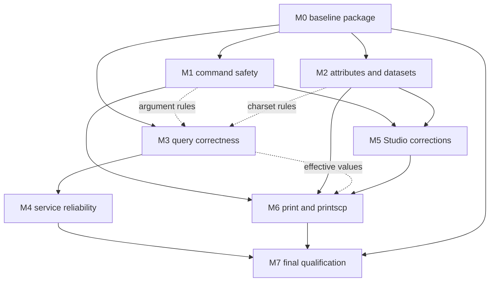

# DICOMKit DICOM 2026a Milestone Implementation Plan

This plan addresses all 68 review items: **46 active items and 22 explicitly deferred items**. Enhancement work is limited to `dicom-print` and `dicom-printscp`. All bug fixes, the script capability correction, audit maintenance and qualification requirements remain in scope.

Baseline: `4b68d7e22829418c88e48dd53d98b25fee50d90d` in `repository root`. The checkout was unchanged and clean when this plan was prepared.

**Implementation status:** M0–M4 item criteria are complete (M4: 14 passed, one conditional not applicable). Stop before M5. Qualification limits remain recorded in the milestone reports. Current results are in [STATUS.md](STATUS.md) and [M4/REPORT.md](M4/REPORT.md). Later gates remain unexecuted.

The [item ledger](items.json) preserves every finding and acceptance assertion. This plan adds sequencing, dependencies, scoped alternatives and separate CLI/app gates.

## Scope and disposition

| Work type | Active | Deferred |
|---|---:|---:|
| Bug fix | 38 | 0 |
| Capability resolution | 1 | 0 |
| Audit maintenance | 3 | 0 |
| Qualification requirement | 2 | 0 |
| Enhancement | 2 | 20 |
| Dormant-component enhancement | 0 | 2 |

The 38 bug-fix actions include related repairs that can share implementation and tests. They are not 38 independent standard violations. CLI syntax and GUI controls are product contracts; the DICOM requirements apply to data and protocol behavior.

Only the two print coverage items move from optional enhancement to planned implementation. Intermediate MPPS updates, QR resume/verbosity/selection, bounded summaries, typed/sequence editing, legacy dictionary expansion, other tool coverage and dormant metadata components remain deferred.

## Milestone sequence

| Milestone | Items | Purpose | Execution order |
|---|---:|---|---|
| M0 | 3 | Baseline and reliable audit reporting | Foundation |
| M1 | 4 | Command argument and execution safety | Critical parallel track |
| M2 | 12 | Attribute integrity and valid workflow datasets | Critical parallel track |
| M3 | 11 | Query safety and exact filter behavior | Critical parallel track |
| M4 | 5 | Cancellation capability reporting and restart behavior | Reliability after critical tracks |
| M5 | 7 | Remaining Studio behavior and contract corrections | Product correctness |
| M6 | 2 | Print SCU and Print SCP in CLI Workshop | Only enhancement milestone |
| M7 | 2 | Final source and packaged app qualification | Final acceptance |

Start with the M0 baseline package. M1, M2 and M3 have parallelizable dependencies, with pagination first in M3. Execution follows the user’s one-milestone-at-a-time authorization; this dependency graph does not authorize later work. Do not delay P1 work for the low-priority audit alias repair. M4 and M5 follow the primitives they use. M6 is the only enhancement milestone. M7 closes qualification after integration.

Arrows identify integration prerequisites. A reusable primitive can unblock dependent work before its full milestone closes. M7 additionally requires complete M0–M6 acceptance; the diagram abbreviates those final edges.

## Milestone deliverables and acceptance gates

### M0 Baseline and reliable audit reporting

Establish reproducible source, fixture and command contracts so later fixes can be measured without repeating the entire audit.

**Items:** AUD-01, AUD-02, AUD-03.

**Dependencies:** None beyond separate implementation authorization.

**Entry gate:** Begin implementation only after it is separately authorized. Recheck the reviewed commit and working tree; reconcile any intervening changes with the register.

**Deliverables**

- Record source commit, dependency lockfiles, build settings, fixture hashes and the CLI/Workshop command inventory. Reuse valid unchanged-source evidence as baseline evidence only.
- Repair audit discovery, obsolete contracts and the private-tag alias false positive. Scripts must finish and report known product failures rather than crash or suppress them.
- Create an acceptance ledger distinguishing passed, failed, blocked, not run and not applicable. Prepare synthetic fixtures and independent peer requirements for M7 early.

**CLI and service acceptance**

- Every enabled CLI product is inventoried; declaration/help checks complete. Known baseline defects have explicit expected-failure records and are never reported passed.
- Audit fixtures preserve correct 2026a dictionary records; a deliberately wrong tag/keyword pairing still fails the alias check.

**Packaged DICOMStudio acceptance**

- All intended Studio audit groups execute, including current anonymization source paths; current Swift files are classified.
- Record the packaged app target and a repeatable launch/test procedure. Source scans are labeled separately from actual GUI execution.

**Exit gate:** The baseline package is usable and audit scripts report all intended checks. Known product failures remain open for their owning milestones.

**Scheduling:** The minimal baseline package unlocks M1–M3. Low-priority alias cleanup and full audit completion must not hold up critical repairs; M0 must be fully closed before M7.

### M1 Command argument and execution safety

Prevent values from changing between a form, copied CLI command and executed operation, and remove shell interpretation from actual Toolbox execution.

**Items:** WS-FIX-01, WS-FIX-02, WS-FIX-05, TB-FIX-04.

**Dependencies:** M0 baseline package.

**Entry gate:** The effective-parameter and argv contract is agreed for Workshop previews and the separate Toolbox execution route.

**Deliverables**

- Use structured executable/argument values for Toolbox execution and complete shell quoting for copied command text.
- Encode leading-hyphen range values unambiguously and use stable tool identity for Basic-auth app-only previews.
- Keep Workshop in-process execution and Toolbox process execution distinct while sharing tested value/argument rules where practical.

**CLI and service acceptance**

- Safe argv-capture tests round-trip DOE*, question marks, backslashes, spaces, apostrophes, quotes, newlines, semicolons and dollar syntax unchanged; no extra command executes.
- ImageType=ORIGINAL\PRIMARY stays one value with its backslash. Open-ended DA/TM ranges reach the intended option and are not mistaken for flags.
- Copied commands either execute equivalently or explicitly identify app-only credentials/capabilities; test credentials are never silently changed.

**Packaged DICOMStudio acceptance**

- In the packaged app, enter the same values, inspect the preview and execute against safe synthetic fixtures; actual values match the controls.
- Toolbox executes one intended process with explicit arguments; metacharacters remain data. Workshop Basic-auth status remains correct after renaming a display label.

**Exit gate:** All four item criteria pass on matching CLI/app artifacts; no unexpected shell execution or argument mutation remains.

**Scheduling:** Run concurrently with M2 and M3 after the baseline package. Provide the argument primitive early to M3 and M6.

### M2 Attribute integrity and valid workflow datasets

Fix malformed edits, false-valid results, identity mismatches and text corruption, then reuse those rules for UPS dates and MPPS references.

**Items:** A-01, A-02, A-03, A-04, A-05, A-06, A-07, A-08, A-09, NET-06-A, NET-06-B, NET-07-A.

**Dependencies:** M0 baseline package.

**Entry gate:** Synthetic malformed, valid, nested, charset and SOP identity fixtures have byte-level expected outcomes.

**Deliverables**

- Create shared VR/VM/date/UID validation and context-dependent VR resolution; route editor and validator consumers through the same rules.
- Synchronize SOP identity, validate nonempty required File Meta values, recurse through sequences and correctly parse numeric copy selectors.
- Implement charset-aware decoding/writing, inherited context and consistent declarations while preserving meaningful whitespace.
- Serialize/parse UPS DT correctly and take MPPS referenced SOP Class from the actual referenced object. Intermediate MPPS N-SET expansion stays deferred.

**CLI and service acceptance**

- All nine malformed edit inputs from A-01 fail with nonzero status and precise tag/VR/VM diagnostics in both dry-run and actual-write tests; failed writes leave originals unchanged. Legal controls remain accepted.
- UID edits produce matching dataset/File Meta identities, including changed-length values; validation rejects mismatches and individually empty Type 1 meta values.
- Nested invalid AS/DA/DT values produce item-path errors; wrong registered VR cannot produce a conformant result. Legal partial DT, timezone and calendar boundaries pass.
- Latin-1 and supported ISO 2022/UTF-8 cases decode and round-trip according to the declaration; undeclared UTF-8 output is rejected or correctly declared. Numeric tag copying selects the requested tag.
- PixelRepresentation=1 resolves a new applicable US/SS field as SS and encodes -1 correctly; unsigned and existing-value controls remain valid.
- Independent request/dataset inspection verifies UPS DICOM DT values and CT/MR MPPS references retain their real SOP Class/Instance UIDs; unsupported references are rejected before sending.

**Packaged DICOMStudio acceptance**

- Run the same edit and validation fixtures through packaged Workshop entry points; status, changed values, files and diagnostics agree with CLI, allowing only presentation formatting differences.
- Read and edit multilingual text in the actual app; declarations and bytes remain consistent. Do not count a source-traced shared library as GUI proof.
- For existing UPS/MPPS app routes, compare controls, effective requests and captured datasets with CLI. Backend-only routes use an explicit not-applicable UI entry instead of adding a new tool.

**Exit gate:** All 12 action criteria pass, malformed writes are prevented, and successful output passes an independent byte/dataset check appropriate to the change.

**Scheduling:** Implement shared primitives first, then editor/validator consumers. UPS/MPPS work needs the relevant DT/identity primitives, not completion of every unrelated attribute item.

### M3 Query safety and exact filter behavior

Prevent malformed pagination from terminating a service and make requested query filters and return fields determine the actual results.

**Items:** NET-01-A, NET-02-A, NET-02-B, NET-02-C, NET-02-D, NET-02-E, NET-02-F, NET-03-A, NET-03-B, NET-04-A, WS-FIX-03.

**Dependencies:** M0 baseline package; M1 argument primitive for preview integration; M2 charset primitive for multilingual integration cases.

**Entry gate:** A small hierarchy of patients, studies, series and instances has predetermined matching sets and returned attribute values.

**Deliverables**

- Fix pagination first, including syntax checks, overflow-safe bounds and provider-level defenses.
- Apply required patient/study/series/instance predicates, Instance Number, PPS/nested keys, UID lists and includefield handling.
- Unify resource-scope rules and Workshop effective filters; eliminate false warnings and stale hidden values.
- For DIMSE filters that cannot be honored by the selected model/negotiation, fail clearly before dispatch or explain an explicit supported alternative. Never silently broaden a query.
- Keep matching-expression validation distinct from scalar value validation: legal DA/TM ranges and wildcards must survive the M2 grammar repair.

**CLI and service acceptance**

- For study/series/instance QIDO endpoints, negative, nonnumeric and extreme pagination inputs do not trap. Invalid syntax returns 400. limit=0 is valid and returns HTTP 200 with []; offset=0 starts at the first match and alone does not imply an empty result.
- Expected result IDs and return attributes match exact fixture oracles for each predicate, combined predicates, UID lists, nested required keys and includefield. Test zero matches and multiple hierarchy levels.
- Captured QIDO/DIMSE requests contain every accepted effective filter. Unsupported filter/model combinations are rejected clearly rather than sent with lost predicates.

**Packaged DICOMStudio acceptance**

- In the packaged app, change query level/resource repeatedly after entering values. Hidden inapplicable values do not affect the preview or request.
- CLI and app given the same effective filters produce the same result IDs and returned values; wildcard, range, UID-list and multilingual fixtures use the shared accepted semantics.
- NET-03-B and WS-FIX-03 have one coordinated repair and one cross-surface regression matrix; do not count two independent hidden-state fixes.

**Exit gate:** All 11 criteria sets pass; pagination cannot terminate the server, accepted filters are never silently dropped and result sets match independent expected data.

**Scheduling:** Start parser/provider and matching repairs immediately after baseline. Only the dependent cross-surface cases wait for M1/M2 primitives.

### M4 Cancellation capability reporting and restart behavior

Make long-running operations cancellable, advertised services accurate and stored instances discoverable after restart when durable operation is claimed.

**Items:** NET-05-A, NET-05-B, NET-09-A, NET-09-B, NET-10-A.

**Dependencies:** M3 matching fixture and result/counter rules.

**Entry gate:** Pending-response and sub-operation test harnesses can stop a request at deterministic points.

**Deliverables**

- Honor C-CANCEL-FIND/MOVE with the required final status and consistent remaining/completed/failed/warning sub-operation counts.
- Implement the required Retrieve Capabilities response and advertise only implemented retrieval handlers; unsupported bulk retrieval must not appear enabled.
- Correct the existing persistence contract through a persistent index or deterministic startup reindex. Until durable mode works, explicitly refuse that mode; do not silently call memory-only storage SQLite. PostgreSQL implementation is outside this plan.

**CLI and service acceptance**

- Cancel FIND/MOVE before the first result, mid-stream and at completion races; final responses, counts and association/resource cleanup are consistent. Existing GET cancellation remains correct.
- OPTIONS/capability responses match available handlers and supported methods; unsupported retrieval fails explicitly and does not advertise success.
- Store, restart, then FIND and GET/MOVE a synthetic object from the same durable directory; SOP identity and content agree. Duplicate/corrupt inputs produce deterministic visible outcomes.

**Packaged DICOMStudio acceptance**

- Existing app query/retrieve routes expose the corrected cancellation outcome and do not remain indefinitely Running; displayed counts agree with protocol evidence.
- Exercise app clients against restarted/capability-corrected services where an existing route applies. Adding dicom-server to Workshop remains deferred; server-only changes have backend gates rather than invented UI parity.

**Exit gate:** All five item criteria pass; no false service or durability claim remains. A refused unsupported durable mode is containment only, not evidence of persistent operation.

**Scheduling:** Protocol/capability work can begin while M3 is in progress; final cancellation and restart gates use its stable matching fixtures.

### M5 Remaining Studio behavior and contract corrections

Remove misleading operations and stale option mappings without expanding non-print features.

**Items:** WS-FIX-04, WS-FIX-06, WS-FIX-07, WS-FIX-08, TB-FIX-01, TB-FIX-02, TB-FIX-03.

**Dependencies:** M1 structured argument rules; M2 DT/text primitives; M0 current CLI contract.

**Entry gate:** The minimal behavior-correction choices below are fixed in scope.

**Deliverables**

- Disable unsupported Workshop live script Run before execution; retain accurate template, validation and dry-run behavior. Do not implement a new live script dispatcher.
- Rename/remove the misleading Interactive retrieve-all choice and retain accurately named Auto/Review behavior. Do not add actual interactive selection.
- Preserve SR TIME/DATETIME precision and UTC offset; deduplicate the Allow Burned-in PHI parameter identity.
- Replace/remove obsolete Toolbox anonymization profiles, flags and invalid script template arguments using the current CLI contract.

**CLI and service acceptance**

- Every retained Toolbox-generated command parses against current CLI help and has the intended safe synthetic result; removed flags/profiles do not appear in new templates.
- SR TIME/DATETIME samples retain value precision and offset when displayed or copied through supported paths; no value-normalization change is hidden as formatting.
- Existing CLI script behavior remains valid; the app limitation is explicit and does not disable supported CLI execution.

**Packaged DICOMStudio acceptance**

- The packaged app prevents unsupported live script execution before it starts; template/validate/dry-run routes work and are labeled accurately.
- No option labeled Interactive retrieves all matches without selection. Auto/Review controls and generated parameters match their stated behavior.
- The duplicate parameter appears once, binds once and changes only the intended flag; SR display retains precision/offset; Toolbox forms and templates produce working current commands.

**Exit gate:** All seven items pass under the scoped correction paths; none requires a deferred enhancement.

**Scheduling:** UI-only corrections can be prepared alongside M4 once the required shared primitive is available.

### M6 Print SCU and Print SCP in CLI Workshop

Add real Workshop coverage for dicom-print and dicom-printscp using their existing CLI and shared print services.

**Items:** WS-COV-07, WS-COV-08.

**Dependencies:** M1 complete; M2 applicable charset/identity/VR gates; M3 effective hidden-parameter rule; M5 current form/parameter contract.

**Entry gate:** Freeze the registered print subcommands, flags, defaults, supported values and existing limitations; each control has a CLI contract and a real execution route.

**Deliverables**

- Register dicom-print and dicom-printscp in Workshop and route execution through existing shared services rather than duplicating a DIMSE print stack.
- Expose registered commands and applicable arguments with validation, accurate previews, status, failures and cancellation. A generic label or link to another panel alone does not close Workshop coverage.
- Provide explicit Print SCP start/stop and listener status, resource cleanup and configuration handling suitable for a long-running service.
- Keep all other enhancement items deferred. This milestone adds parity for existing print capabilities, not unrequested new print SOP classes or printer features.

**CLI and service acceptance**

- Every registered print/printscp command has valid and invalid contract tests; meaningful flag combinations, defaults, enum values, files, connection failures and output modes are exercised.
- For every claimed print SOP role, capture and validate the relevant negotiated N-CREATE/N-SET/N-ACTION/N-GET/N-DELETE/N-EVENT-REPORT and response/status behavior against the frozen 2026a requirements.
- Validate film/image box references, mandatory attributes, pixel representation, dimensions and bit depth for claimed grayscale/color paths using independent expected data.
- Print SCP bind/start/stop/restart, occupied port, peer disconnect, malformed requests and output failures return explicit status and release resources.

**Packaged DICOMStudio acceptance**

- Run the same synthetic print jobs from CLI and packaged Workshop; compare effective values, encoded datasets, statuses and produced output rather than only preview text.
- Printer profile operations have the intended persistent effects and agree with the current CLI contract; no stale hidden setting leaks between commands.
- Start and stop Print SCP from the actual app; UI stays responsive, state is truthful, Stop releases the listener, and window/application lifecycle follows an explicitly tested service policy.
- Test client/server combinations across CLI and app, followed by an independent print peer in each claimed direction. A self-to-self round trip alone cannot establish interoperability.

**Exit gate:** Both tools have complete scoped Workshop routes and packaged-app evidence. Independent protocol interoperability is required for that claim; physical film/driver quality remains unqualified without actual target hardware.

**Scheduling:** CLI contract/unit work can begin earlier, but print enhancement integration follows critical repairs. After the shared contract/configuration decisions, the SCU and SCP adapters can proceed in parallel; joint qualification waits for both. Detailed print-specific gates and limits follow below.

### M7 Final source and packaged app qualification

Qualify the integrated result on a known source and binary set and publish an accurate capability statement.

**Items:** QUAL-01, QUAL-02.

**Dependencies:** M0; M1; M2; M3; M4; M5; M6.

**Entry gate:** All active implementation items have their required evidence; deferred capabilities are explicitly excluded and any environmental blockers are recorded.

**Deliverables**

- Build the integrated source once for acceptance, record artifact identities, run relevant XCTest and Swift Testing suites, and execute the real packaged-app matrix.
- Run independent protocol and codec checks for retained claims, including both print roles; align the PS3.2 conformance statement with demonstrated capabilities.
- Publish item-by-item status, CLI/app outcomes, fixture and artifact hashes, external peer/platform versions, limitations and reproducible logs.

**CLI and service acceptance**

- All active item assertions applicable to the chosen correction path pass on the final build. No zero-test suite or unexecuted external check counts as passed.
- Every enabled CLI product and registered command retains a successful help/parse contract check; changed behavior has meaningful positive/negative tests. Prior cached results are not substituted for this build.
- Independent endpoints/oracles verify retained matching, cancellation, print, SOP roles, transfer syntaxes, claimed codecs and TLS profiles where applicable; unavailable gates remain blocked or not run.

**Packaged DICOMStudio acceptance**

- Every changed existing Workshop/Toolbox route and both new print routes passes on the packaged app built from the recorded source.
- The unique-tool inventory increases from 30 to 32 of the 41 enabled executables if the baseline inventory remains unchanged; the other nine missing Workshop tools remain explicitly outside scope.
- Record UI actions, expected vs actual values, request/output evidence and status. A unit-test or view-model-only result cannot substitute for a real app action.

**Exit gate:** All 46 active items meet their applicable closure criteria, with all required qualification gates passed. If hardware/peer/platform evidence is unavailable, report the corresponding qualification as blocked; completed bug milestones can remain accepted independently.

**Scheduling:** Prepare peers and fixtures in M0, use targeted checks during each milestone, and run the broad final campaign once after integration. Re-run only what later changes or failures invalidate.

## Scope choices that prevent unintended enhancement work

| Item | Chosen implementation scope |
|---|---|
| WS-FIX-04 | Use the disable-before-run correction. The alternative of implementing a live script dispatcher is excluded from this plan. |
| WS-FIX-06 | Rename/remove the misleading mode. Actual interactive selection (WS-ENH-04) is deferred. |
| NET-10-A | Prefer a persistent index or deterministic restart reindex for the existing durable contract. Explicit refusal is permitted as an interim containment, not a durability pass. No PostgreSQL enhancement. |
| WS-COV-07 | Implement and qualify Workshop coverage. The original optional exclusion alternative is superseded by the requested print enhancement scope. |
| WS-COV-08 | Implement and qualify Workshop coverage with service lifecycle behavior. The original optional exclusion alternative is superseded by the requested print enhancement scope. |
| NET-03-B | Share the hidden-filter regression matrix with WS-FIX-03; retain separate warning-rule ownership without duplicate implementation. |
| QUAL-01 | Preparation begins in M0 and per-milestone evidence is collected throughout; final closure belongs only to M7. |
| QUAL-02 | Prepare independent peers early. Test existing retained capabilities and the two print roles; do not add other enhancements. |

For WS-FIX-04, the original dispatcher-specific AC01 is not applicable to the selected disable-before-run correction; AC02–AC04 remain required. For both print coverage items, the original “implemented or excluded” choice is replaced by implemented and qualified Workshop coverage. Other conditional assertions apply only where their stated condition exists; every exception requires a recorded reason.

## All 68 item assignments

Every ID appears once below. Dependencies reference item completion or the specific shared primitive/evidence it provides. An item without an explicit item dependency still observes its milestone entry gate.

| Item | Priority | Milestone | Work | Item dependencies |
|---|---|---|---|---|
| A-01 | P1 | M2 | Tag edits accept malformed syntax, wrong VM and non-ASCII AE | — |
| A-02 | P1 | M2 | Edited SOP identity disagrees with File Meta identity | — |
| A-03 | P1 | M2 | Text read/write ignores Specific Character Set | — |
| A-04 | P1 | M2 | Validation omits nested sequence attribute values | A-01, A-05 |
| A-05 | P2 | M2 | Invalid calendar DA and malformed DT pass validation | A-01 |
| A-06 | P1 | M2 | File Meta Type 1 values are not fully validated | A-02 |
| A-07 | P2 | M2 | Wrong registered VR is reported valid | A-01 |
| A-08 | P2 | M2 | Numeric copy-tag selector silently loses the requested tag | A-03 |
| A-09 | P2 | M2 | New signed US/SS attribute is incorrectly selected as US | A-01 |
| NET-01-A | P1 | M3 | Validate QIDO pagination and make slicing overflow safe | — |
| NET-02-A | P1 | M3 | Apply patient and study predicates to series searches | — |
| NET-02-B | P1 | M3 | Apply parent predicates to instance searches | — |
| NET-02-C | P1 | M3 | Index and match Instance Number in QIDO | — |
| NET-02-D | P1 | M3 | Match required PPS and nested request attributes | — |
| NET-02-E | P2 | M3 | Implement QIDO UID-list matching | — |
| NET-02-F | P2 | M3 | Preserve and honor QIDO includefield selection | — |
| NET-03-A | P1 | M3 | Validate outgoing QIDO filters against the target resource | — |
| NET-03-B | P2 | M3 | Correct false QIDO key-level warnings; coordinate hidden-filter state | NET-03-A, WS-FIX-03 |
| NET-04-A | P1 | M3 | Reject or explain C-FIND filters that would be dropped | — |
| NET-05-A | P2 | M4 | Honor C-CANCEL-FIND while matches are pending | — |
| NET-05-B | P2 | M4 | Honor C-CANCEL-MOVE and preserve sub-operation counts | NET-05-A |
| NET-06-A | P1 | M2 | Serialize UPS start time using DICOM DT syntax | A-05 |
| NET-06-B | P1 | M2 | Parse valid UPS DICOM DT without losing scheduling information | A-05, NET-06-A |
| NET-07-A | P1 | M2 | Stop guessing Secondary Capture for MPPS image references | A-02, A-06 |
| NET-08-A | P2 | Deferred | Support intermediate MPPS N-SET updates | — |
| NET-09-A | P2 | M4 | Implement the DICOMweb Retrieve Capabilities transaction | — |
| NET-09-B | P2 | M4 | Make capability flags reflect implemented retrieval handlers | NET-09-A |
| NET-10-A | P2 | M4 | Make the advertised SQLite index durable or explicitly volatile | — |
| WS-FIX-01 | P1 | M1 | Preserve DICOM values in copied shell commands | — |
| WS-FIX-02 | P1 | M1 | Emit leading-hyphen DA/TM ranges as option values | WS-FIX-01 |
| WS-FIX-03 | P1 | M3 | Exclude hidden QIDO values from the effective request | NET-03-A |
| WS-FIX-04 | P2 | M5 | Resolve unsupported live script execution explicitly | — |
| WS-FIX-05 | P2 | M1 | Detect Basic-auth app-only previews using stable tool IDs | — |
| WS-FIX-06 | P2 | M5 | Stop labeling retrieve-all behavior as Interactive selection | — |
| WS-FIX-07 | P2 | M5 | Preserve SR TIME/DATETIME precision and UTC offset | A-05, A-03 |
| WS-FIX-08 | P2 | M5 | Deduplicate Allow Burned-in PHI parameter identity | — |
| WS-ENH-01 | P3 | Deferred | Expose dicom-info bounded-summary in Workshop | — |
| WS-ENH-02 | P3 | Deferred | Add QR resume with state and resume-specific options | — |
| WS-ENH-03 | P3 | Deferred | Expose QR verbose mode | — |
| WS-ENH-04 | P3 | Deferred | Implement actual interactive QR result selection | — |
| WS-DORM-01 | P3 | Deferred | Resolve legacy metadata numeric rendering before reuse | — |
| WS-DORM-02 | P3 | Deferred | Preserve exact values and VM in legacy metadata copy | — |
| TB-FIX-01 | P2 | M5 | Remove unsupported Toolbox anonymization profiles | AUD-01 |
| TB-FIX-02 | P2 | M5 | Remove or migrate removed Toolbox anonymization flags | AUD-01 |
| TB-FIX-03 | P2 | M5 | Correct Toolbox script template arguments | AUD-01, TB-FIX-04 |
| TB-FIX-04 | P1 | M1 | Execute Toolbox commands through structured argv | — |
| WS-COV-01 | P3 | Deferred | Optional Workshop coverage for dicom-3d | — |
| WS-COV-02 | P3 | Deferred | Optional Workshop coverage for dicom-ai | — |
| WS-COV-03 | P3 | Deferred | Optional Workshop coverage for dicom-gateway | — |
| WS-COV-04 | P3 | Deferred | Optional Workshop coverage for dicom-j2k | — |
| WS-COV-05 | P3 | Deferred | Optional Workshop coverage for dicom-jpip | — |
| WS-COV-06 | P3 | Deferred | Optional Workshop coverage for dicom-measure | — |
| WS-COV-07 | P3 | M6 | Optional Workshop coverage for dicom-print | WS-FIX-01, WS-FIX-02, WS-FIX-03, A-03, A-06, WS-FIX-08 |
| WS-COV-08 | P3 | M6 | Optional Workshop coverage for dicom-printscp | WS-FIX-01, WS-FIX-03, A-03, WS-FIX-08 |
| WS-COV-09 | P3 | Deferred | Optional Workshop coverage for dicom-report | — |
| WS-COV-10 | P3 | Deferred | Optional Workshop coverage for dicom-server | — |
| WS-COV-11 | P3 | Deferred | Optional Workshop coverage for dicom-viewer | — |
| AUD-01 | P2 | M0 | Update obsolete CLI anonymization contract rows | — |
| AUD-02 | P1 | M0 | Repair Studio audit source discovery and inventory | — |
| AUD-03 | P3 | M0 | Remove the private-tag-alias lint false positive | — |
| CAP-01 | Scope decision | Deferred | Provide JPIP fetch only when dependency support is real | — |
| CAP-02 | Scope decision | Deferred | Implement or explicitly limit DICOM gateway networking | — |
| CAP-03 | Scope decision | Deferred | Decide the dicom-3d volume-rendering feature | — |
| CAP-04 | Scope decision | Deferred | Resolve disabled dicom-cloud product and catalogs | — |
| ENH-ATTR-01 | Scope decision | Deferred | Extend typed and sequence-path editing deliberately | — |
| ENH-ATTR-02 | P3 | Deferred | Declare or extend retired wildcard dictionary coverage | — |
| QUAL-01 | P1 | M7 | Qualify a frozen source build and the real packaged Workshop | — |
| QUAL-02 | P1 | M7 | Prove claimed external protocol and codec interoperability | — |

## Evidence and closure rules

- Each active item inherits its original register assertions except explicit scoped alternatives below. Milestone gates add paired CLI/app and integration requirements.
- Record Passed, Failed, Blocked, Not run or Not applicable separately. Not applicable requires a documented route/scope reason; it cannot excuse a required but untested operation.
- For each existing affected GUI route, compare effective input, shared request/dataset, output/files and error/cancellation status with CLI; textual presentation need not be byte-identical.
- Backend-only changes do not require adding deferred Workshop tools. Test existing app consumers where available and record exact UI applicability.
- Independent verification may use a developer other than the implementer, but no person, external agent, branch, PR or release action is assigned by this plan.
- Fixes must preserve validated dictionary IDs and existing supported operations. All milestones use synthetic data and isolated test output.
- Implementation acceptance does not automatically authorize merge, publishing, release or deployment.

For each active item, retain the source/binary identities, fixtures, criterion results, CLI logs, packaged-app actions, expected/actual request and output values, independent-peer details and unresolved limits. The companion JSON supplies the 68-item disposition, dependencies and inherited assertion text for execution tracking.

Prepare independent peers, target platforms and print-output resources at M0. If a required peer or platform is unavailable, keep that qualification gate blocked or not run. A completed bug milestone does not need to be reopened merely because a separate hardware gate is unavailable, but overall qualification must not be declared complete.

Use targeted tests during development and one integrated final campaign. The earlier 504 cached-binary passes remain baseline evidence, not proof of the new source or packaged GUI. Do not repeat unchanged broad audits without a change, failure or unresolved concern that justifies them.

## Standards and capability boundaries

Apply the existing register’s frozen DICOM 2026a references: PS3.5 and PS3.6 for value representation and dictionaries; PS3.10 for file identity; PS3.3 and PS3.4 for applicable information objects and services; PS3.7 for DIMSE behavior; PS3.18 for DICOMweb; and PS3.2 for the capability statement. Print management uses the applicable PS3.4 Annex H roles and operations, not a requirement to implement every optional print feature.

Simulator output, independent DICOM print interoperability, operating-system spooler success and physical film quality are separate results. Qualify only the levels actually exercised. This plan does not expand printer features, SOP roles, codecs, cloud, gateway or other deferred capabilities.

## Detailed print implementation contract

M6.0 establishes shared contracts and configuration decisions. M6.1 and M6.2 can then proceed in parallel. M6.3 requires both adapters and feeds the final M7 qualification record. All gates below are proposed and unexecuted.

### Current print foundation

Add `dicom-print` and `dicom-printscp` to DICOMStudio CLI Workshop with their **existing** command contracts. Complete Workshop parity means six print subcommands and four printscp subcommands, including their default-command behavior. It does not mean new Print Management SOP Classes, layouts, rendering capabilities, transports, devices, presets, or a replacement for the separate Print Center and Print SCP screens. The other nine missing CLI tools remain out of scope.

The current Workshop dispatcher has no route for either tool (`Sources/DICOMStudio/ViewModels/CLIWorkshopViewModel.swift:5214–5295`). Existing Studio printing already uses shared DICOMPrintKit; it does not establish Workshop support. Reuse that foundation, while preserving CLI file/frame inputs: Studio PrintService.prepare has viewer-specific marked-frame/window/annotation behavior, so calling it blindly would change CLI semantics.

Relevant implementation seams:

- `Sources/dicom-print/main.swift:28` root/default command; `:125` status, `:207` send, `:714` job, `:798` list-printers, `:885` add-printer, `:950` remove-printer. Send builds `PrintJobRequest` at `:355`, validates it, and uses `PrintWorkflow.preflight` at `:499` and execute at `:548`.
- `Sources/DICOMPrintKit/PrintImagePreparer.swift:102` prepares paths with request-wide frame selection. `Sources/DICOMPrintKit/PrintJobRequest.swift:446` holds shared request validation. `Sources/DICOMPrintKit/PrintWorkflow.swift:72`, `:136`, `:265`, `:276` own preflight, execution, job query and printer query; `Sources/DICOMPrintKit/PrintConsoleFormatter.swift` owns corresponding text/JSON formatting. `Sources/DICOMPrintKit/PrintOptionCatalog.swift:177–284` owns existing term/token choices.
- `Sources/dicom-printscp/DICOMPrintSCPCommand.swift:24–68` root/default serve command. `Sources/dicom-printscp/ServeCommand.swift:51–155` owns listener lifecycle and event/film subscriptions, duration/film limits and stop. `Sources/dicom-printscp/SimulateCommand.swift:126` invokes the shared simulator. `Sources/dicom-printscp/InfoCommands.swift:47` resolves local status and `:92` lists paper queues.
- `Sources/DICOMPrintKit/Printing/PrintSCPService.swift:49`, `:103`, `:117` assemble sinks, composer handler and server. `Sources/DICOMPrintKit/Printing/PrintSCPSimulator.swift:45`/`:63` provide local composition. `Sources/DICOMPrintKit/Printing/PrintSCPSettings.swift:493` maps settings to protocol configuration; `:542` defines shared settings serialization. `PrintSCPConsole` supplies event/status formatting.
- `Sources/DICOMStudio/ViewModels/PrintSCPViewModel.swift:175–244` demonstrates app-owned event streams and graceful server stop. Reuse the service/lifecycle pattern without sharing mutable run state with an already-running separate Print SCP screen.

### Frozen standards basis

Use the downloaded official 2026a DocBook in `work/standards/part04_2026a.xml` and `part07_2026a.xml`. PS3.4 Annex H.3 defines conformance by supported Basic Print Management Meta SOP Classes and optional SOP Classes; H.5 governs negotiation and association cleanup. H.4.1 film session, H.4.2 film box, H.4.3 image boxes, H.4.4 annotations, H.4.5 print jobs, H.4.6 printer and H.4.9 Presentation LUT define the applicable operations. PS3.7 10.1.1–10.1.6 define N-EVENT-REPORT, N-GET, N-SET, N-ACTION, N-CREATE and N-DELETE. Relevant attribute encodings/terms additionally use the already-frozen PS3.3 C.13 and C.11.4 and PS3.6 dictionary/UID tables.

These standards govern DICOM messages, values, negotiation and state. CLI option names, Workshop controls, JSON compatibility keys, configuration locations and PNG/PDF/paper routing are product contracts. A CLI-to-Workshop comparison establishes parity, not independent DICOM conformance. Optional features must be checked against peer negotiation/conformance statements; their absence alone is not a standard violation.

### M6.0 Freeze the print command contracts

Deliverables: checked-in implementation-era contract matrix generated from the source, fixture manifest, expected validation/console/result samples, and explicit supported surface for all ten commands. This planning inventory is [print command inventory](print-cli-contract.json), with source hashes and line references. It includes 55 print and 72 printscp parameter declarations; inherited groups expand to 40 status, 43 serve and 41 simulate parameters for printscp. Counts include positional arguments but exclude built-in help/version and count one declaration once regardless of aliases.

Resolve these dependencies before asserting parity:

- Workshop command serialization/parsing must round-trip backslashes, quotes, spaces, shell metacharacters, repeatable values and leading-negative numeric values. Existing register items WS-FIX-01/02/03 (quoting, option-value parsing, effective hidden parameters) are dependencies where applicable; do not invent extra print flags to work around them. A print-specific acceptance case is literal `ROW\1,3`, repeated annotations, and `--window-center -600 --window-width 1500`.
- Decide and document a concrete persistence adapter. CLI printer records use `~/.config/dicomkit/printers.json` via `Sources/dicom-print/main.swift:1313`; Studio's existing printer profiles use a different schema/location (`Sources/DICOMStudio/Services/PrinterProfileStorageService.swift:20`). Do not silently interpret one as the other. Workshop add/list/remove must operate on one coherent store with the CLI record semantics; an app-sandbox location difference must be explicit and tested. No new configuration flag is part of this enhancement.
- Printscp CLI settings use defaults, optional `~/.config/dicomkit/printscp.json`, or explicit `--config`, then explicit overrides; `--save-config` writes resolved settings and exits. Existing Studio SCP storage has the same shared document schema but its own location (`Sources/DICOMStudio/Services/PrintSCPSettingsStorageService.swift:24–49`). Show effective location, honor user-selected file access, and retain unset-versus-explicit false for inverted flags.
- Preserve the existing paper gate: `--paper-queue` requires `--allow-paper` (`Sources/dicom-printscp/EmulatorOptions.swift:249–263`). Merely entering/selecting a queue must not spool paper. Existing window/file access mechanisms, writable output folders, Network/CoreGraphics support and a lifecycle-safe async execution adapter are prerequisites.

Exit gate: every inventory row maps to a control/advanced argument, request/config field, execution path and observable result; every intentional app storage difference is documented. No unreachable control or accepted-but-ignored parameter is counted as complete.

### M6.1 dicom-print Workshop adapter

Deliverables: Workshop catalogue, parameter forms, command preview/import and in-process handlers for `status`, `send`, `job`, `list-printers`, `add-printer`, `remove-printer`; `send` is the default. Share workflow/preparation/formatting/catalogue code and preserve CLI-level argument checks. If command-layer mapping must be shared/extracted during implementation, keep the CLI public contract unchanged. Do not enable viewer-specific transforms or corner annotations implicitly.

Acceptance gates:

1. Each existing option/default/alias is exercised through CLI and Workshop with equivalent normalized requests/configurations. Include `--layout` versus `--template`, frame versus all frames, paired window values, raw restrictions, annotation format requirement, copies/retries validity and existing 16-to-12-bit compatibility clamp. `--raw` has no `--no-raw` alias in current source.
2. A synthetic monochrome, RGB, multi-frame and supported compressed-image set reaches equivalent prepared frames, film plan/layout and pixel output at matching options. Preserve paths/file order, directory recursion, frame numbering, palette behavior, supported bit depths and preprocessing. Unsupported inputs produce equivalent errors; do not require adding a codec.
3. Dry run prints the equivalent plan and submits no print operation. Verify the current CLI treatment of optional preflight during dry run and match it explicitly; do not assume dry run means zero network traffic. Printer FAILURE with `--check-status` aborts; WARNING remains visible. Retry tests distinguish connection/setup retry from a duplicate completed print.
4. `status` and `job` text/JSON preserve DICOM keyword fields, legacy compatibility fields and date/time conventions; normalize only dynamic UIDs/timestamps/elapsed values when comparing. Failure/cancellation cannot be reported as success.
5. In an isolated settings fixture, add/list/remove/default selection match CLI semantics, duplicate-name and missing-name errors, persistence after relaunch, and actual displayed store location. No modification to the user's real printer configuration is needed for qualification.

Exit gate: all six commands pass automated adapter/contract comparisons and packaged-app interactive gates below. Successful separate Print Center operation alone is insufficient.

### M6.2 dicom-printscp Workshop adapter

Deliverables: Workshop catalogue, forms, preview/import and handlers for `serve`, `simulate`, `status`, `queues`; `serve` is the default. Wire existing transport/composition/output/config options through shared settings, services, simulator and console formatters. The app owns cancellation; do not install CLI SIGINT behavior in the app process. Preserve JSON event stream semantics and quiet/verbose behavior.

Acceptance gates:

1. Resolve defaults and configuration overrides equivalently, including each positive/negative flag, repeated allow/deny AEs, accepted film sizes/media, PDU/resource limits, printer identity/status and existing optional color/LUT/annotation/job-event switches. `status` does not bind a port; `queues` only enumerates OS queues. `--save-config` writes then exits without starting/printing.
2. `simulate` processes the same fixtures as M6.1 locally; compare composed dimensions/cell placement/annotations and decoded PNG/TIFF/PDF raster output under identical existing settings. Retain orientation, polarity, trim, densities, magnification, frame/window/raw/bit-depth behavior. Compare pixel content and required document properties rather than timestamp-bearing file bytes. It must not require a network peer.
3. Serve start subscribes before accepting films; event/film outputs, saved-file notifications, counters, `--max-films`, `--duration` and user cancellation are observable. Stop releases listener/associations/tasks; restarting works. Port collision with another Workshop run or the separate Print SCP screen surfaces a clear error without stopping the other listener.
4. Existing `--output` choices are png, tiff, pdf and none; repeatability and effective resolved combinations must match current CLI behavior. Test write failures, inaccessible folders, filename tokens and `--open` with synthetic files. Keep a screen/console outcome visible when a nonessential sink fails according to existing service policy; do not misreport failed persistent output as saved.
5. `--paper-queue` without `--allow-paper` refuses. Queue enumeration and gated spool dispatch can be tested with a controlled substitute; actual spool/printed output remains a separate environment gate. Defaults/config alone must not accidentally enable paper output.

Exit gate: all four commands, inherited groups and lifecycle cases pass adapter/contract comparisons and packaged-app interactive gates below.

### M6.3 Joint CLI packaged app and protocol qualification

1. Freeze final source revision, build configuration, CLI hashes, packaged application identity and hash and fixture hashes. Build/test only when implementation is separately authorized; this planning task authorizes none.
2. Launch the actual packaged DICOMStudio. In CLI Workshop select both tools and every subcommand; exercise ordinary and advanced controls, preview/copy/import, Run, progress, errors, results, cancel, retained settings and relaunch. Confirm the actual packaged route invokes the intended adapter; source tests or a command-line test host do not substitute for this check.
3. Local cross-direction loopback: CLI print to Workshop printscp; Workshop print to CLI printscp; CLI-to-CLI as control. Use temporary output/config directories, synthetic images and an unprivileged test port. Cover grayscale and color, optional capability acceptance/refusal, status/job queries, annotation/LUT paths, supplied failure/warning status, AE rejection and enabled job events. These peers share DICOMKit code, so call this parity/state-machine evidence.
4. Inspect captured association and DIMSE datasets against frozen H/PS3.7 references for existing negotiated SOP Classes, request/response identifiers, legal values and completion/failure state. Confirm image data is prepared for image boxes, not copied from compressed source payloads unchanged. Verify film/session/image/optional object handling and cleanup without claiming all optional classes are mandatory. Keep privacy-safe captures and exact expected-status assertions.
5. Run an independent implementation as SCU and/or SCP for the supported capabilities, recording peer name/version/conformance statement and negotiation. Match the claims to capabilities actually tested; a printer lacking an optional SOP Class cannot qualify it. Independent-peer failures require diagnosis, not an automatic Workshop defect attribution.

Exit gate: separate status for contract/adapter, packaged UI, same-library loopback, independent interoperability and physical output. Do not label an unavailable gate passed or waived.

### Environment blockers and limits

- Without an independent Print Management peer, independent interoperability remains blocked/unexecuted even when same-library loopback passes.
- Without a physical DICOM film printer and its conformance statement, real-device negotiation, print job completion and resulting film quality remain unverified. Color/LUT/annotation combinations require a peer that advertises those optional capabilities.
- Without a usable OS/CUPS queue and real printer, paper spool completion/output remains unverified. A stub establishes dispatch/gating only.
- Physical density, calibration, diagnostic grayscale/colour fidelity, media/film behavior and printer-specific layout/annotation constraints require appropriate hardware and measurement procedures. PNG/PDF comparison cannot establish those properties; this enhancement does not add calibration or new printing features.
- Packaged-app sandbox access, Network entitlement/support, output permissions and a desktop session are required for actual UI qualification. If unavailable, retain a pending gate rather than replacing it with library tests.

### Inventory notes

[print command inventory](print-cli-contract.json) lists all current declaration lines, spelling aliases, types, defaults, repeatability, direct/inherited parameters and source hashes. Print subcommand counts: status 6, send 32, job 7, list-printers 2, add-printer 7, remove-printer 1. Printscp counts after inheritance: serve 43, simulate 41, status 40, queues 1. Command roots also supply ArgumentParser help/version/default routing, which require checks but are not parameter declarations.

The extractor deliberately strips help prose before identifying inversion metadata: an existing general audit extractor mistakes the word “inversion” in raw help for a declaration of `--no-raw`. Both current raw flags are positive only. Optional inverted SCP flags are nil when absent and inherit defaults/configuration; they are not false. Dynamic token lists in help are retained as source expressions and point to the shared option catalog rather than inventing extra accepted values.
